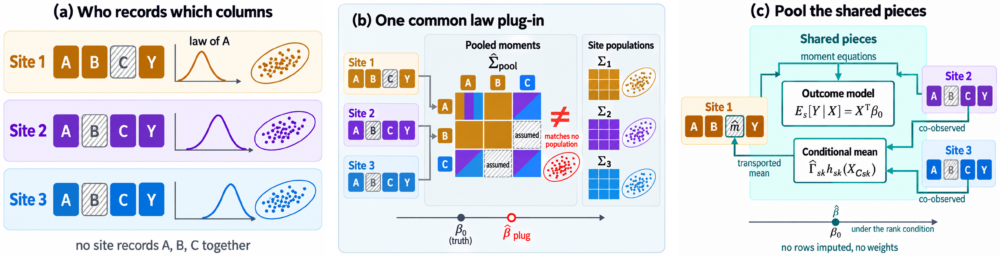
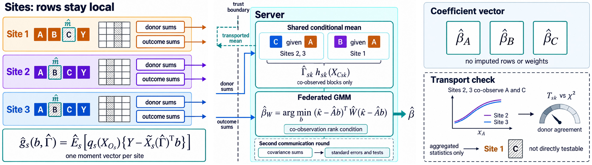
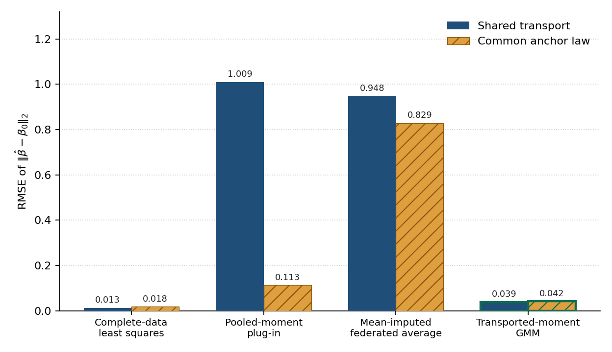

# Transported-moment GMM

**Missing columns that follow different covariate laws are not missing the way a pooled moment matrix assumes.**

Sites that share a linear outcome often record different feature blocks, and the sites that record a block often follow a different covariate law from the sites that do not. Transported-moment GMM borrows only the conditional mean of each missing block, given a conditioning set that is recorded with that block elsewhere, and solves the stacked site moment equations. Rows stay on the site. The estimator does not impute a row and does not use importance weights. The paper is *The Missing Columns Are Not Missing the Way We Assumed*.

<p align="center">
  <a href="#quick-start"><strong>Quick start</strong></a>
  &nbsp;·&nbsp;
  <a href="#reproduce"><strong>Reproduce</strong></a>
  &nbsp;·&nbsp;
  <a href="#layout"><strong>Layout</strong></a>
</p>

## Different laws, spliced moments

No site records every block, and the law of the anchor block shifts across sites. Pooling each second-moment cell over the sites that happen to record that pair splices those laws, so the assembled matrix need not belong to any site. Transport leaves each site's law alone and substitutes the conditional mean of a missing block, estimated where that block is co-observed with the anchor.

<p align="center">
  
</p>

## Sums in, coefficient out

Each site returns donor sums for the conditional means it can see, and outcome sums for the blocks it records with the anchor. The server fits those shared conditional means, stacks the site moment equations, and solves a two-step GMM. A Wald comparison of the two donors of each conditional mean checks whether the maps agree. The check uses aggregated Gram matrices, not the rows.

<p align="center">
  
</p>

## Error stays near the complete-data fit

Under shared transport the transported-moment estimator stays near complete-data least squares. The pooled-moment plug-in and mean-imputed federated averaging stay near an error of one. Giving every site the same anchor law pulls the plug-in down by about an order of magnitude and barely moves the transported estimator. The bars are the root-mean-square Euclidean coefficient error over 100 replications with 2000 rows at each site.

<p align="center">
  
</p>

## Quick start

Python 3.10+ recommended.

```bash
pip install -r requirements.txt
python scripts/smoke.py
```

Smoke uses seeds 0 and 1 with 800 rows per site. It exits non-zero if, under shared transport, the transported estimator is not closer to the true coefficient than the plug-in and the federated average, if the plug-in is not worse under site-specific anchor laws than under a common law, or if a shifted donor map is not rejected.

`python scripts/plot_design.py` writes the site-by-block pattern to `figures/block_pattern.png`.

## Reproduce

Printed coefficient comparison (100 seeds, 2000 rows per site):

```bash
python scripts/run_grid.py --seeds 100 --n-train 2000 --n-test 2000 --out results/paper_s100
```

Sample size, anchor-mean separation, and donor count:

```bash
python scripts/run_expand.py --campaign nsweep
python scripts/run_expand.py --campaign shift
python scripts/run_expand.py --campaign donors
python scripts/eval_expand.py
```

`eval_expand.py` reads `results/paper_s100` together with the three campaigns above. Outputs go under `results/` (gitignored). The grid is closed form. Seeds are NumPy `SeedSequence` keys `(seed, regime, site, split)`.

```bash
python scripts/run_grid.py --help
python scripts/run_expand.py --help
```

## Layout

```
sb1/            design, moment estimators, experiment driver
scripts/        smoke test, grid, expansions, design plot
docs/figures/   figures used above
figures/        site-by-block pattern from plot_design.py
```

## Notes

- The conditioning set is the anchor block. Conditional means of the other two blocks are linear in a fixed Fourier basis of that anchor, and the basis contains the data-generating map.
- Donor maps are pooled by stacking Gram matrices, including when the Wald test rejects.
- The GMM is two-step. Each site moment covariance is ridged by \(10^{-8}\) times its average diagonal.
- Sites that record the two non-anchor blocks and not the anchor supply a cross-moment to the plug-in and a local coefficient to federated averaging. They do not supply a GMM outcome moment.
- The common-anchor-law regime is the control in which the plug-in is the usual missing-completely-at-random splice.
- `transport_violated` shifts one donor map for each non-anchor block. That regime is for the Wald check.
